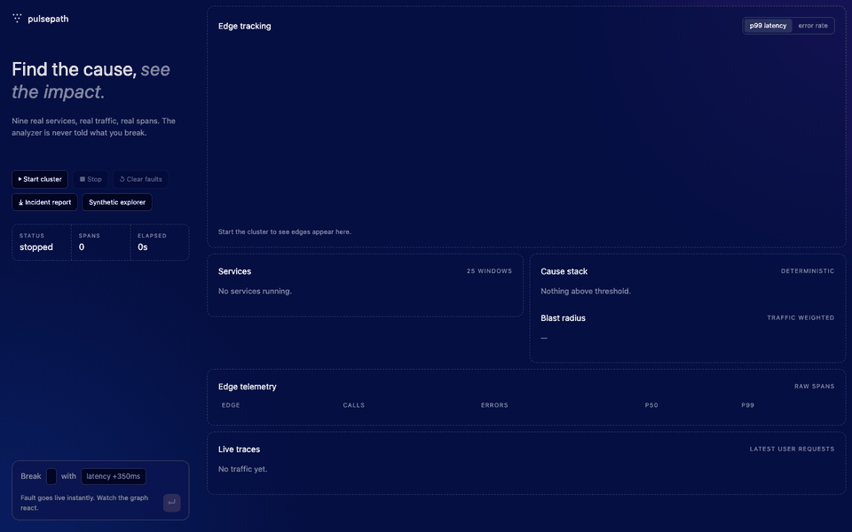
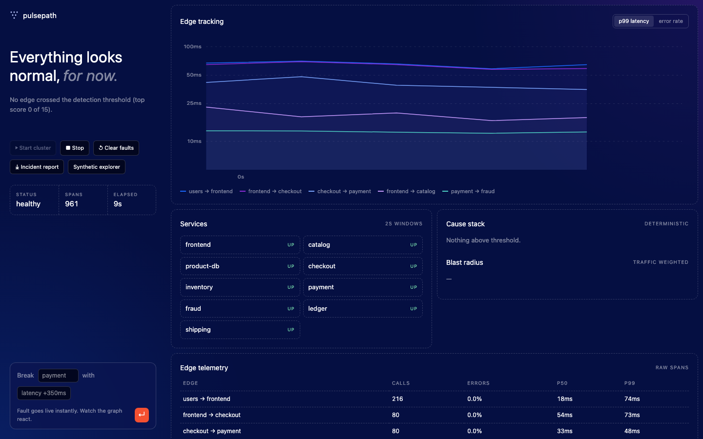

# Pulsepath demo: find the broken service in 60 seconds

Pulsepath runs nine real microservices on your machine, sends real traffic through them, lets you break one, and finds the root cause **using only the raw spans the services emit**. The analyzer is never told what you broke.



## Run it yourself

Requirements: Python 3.9+ (standard library only, no installs).

```sh
git clone https://github.com/MadScientistl/pulsepath.git
cd pulsepath
make ui
```

Open <http://127.0.0.1:8080/web/live.html> and follow along.

## Walkthrough

**1. Start the cluster.** Press **Start cluster**. Nine services (`frontend, catalog, product-db, checkout, inventory, payment, fraud, ledger, shipping`) launch as separate processes and a load generator begins sending about 25 requests per second.



Wait about 20 seconds. The analyzer is learning what normal latency looks like for every edge it discovers in the traces.

**2. Break something.** In the box at the bottom left, pick a service and a fault, then press Enter or the red button:

| Fault | What actually happens |
| --- | --- |
| latency | every request to that service sleeps about 350 ms extra |
| errors | 35% of requests return HTTP 500 |
| retry storm | 60% of requests fail slowly with 503 and callers retry |
| process down | the service process is killed, callers get connection refused |

**3. Watch the diagnosis.** Within a few seconds the graph shows the spike, the headline names the root cause, and the cause stack ranks the suspect edges.


The green line at the left ("Ground truth") compares the answer with what you injected. The analyzer never sees that value.

**4. Export the incident record.** Press **Incident report** in the left rail to download a Markdown report: summary, ranked suspects, blast radius, SLO alerts, recommended next steps and, for the demo, whether the diagnosis matched what you injected.

**5. Reset and try another.** Press **Clear faults**, then inject a different fault or target a different service.

## What to look at

- **Edge tracking graph:** p99 latency (or error rate) per service-to-service edge over time. Dashed markers show when the fault was injected and when it was diagnosed. Hover for exact values.
- **Cause stack:** edges ranked deterministically from error rate, retry amplification, latency lift and onset time. No LLM involved.
- **Blast radius:** which callers and dependencies are affected, weighted by observed traffic.
- **Live traces:** the most recent real user requests, span by span.

## Known limits

- Let the baseline run for ~20 s before injecting, or the "normal" it compares against is already contaminated.
- A healthy cluster can show a low score (about 5) from jitter. The page only declares an incident above 15.
- Errors that callers successfully retry are partly hidden, so error faults give a weaker signal than latency faults.
