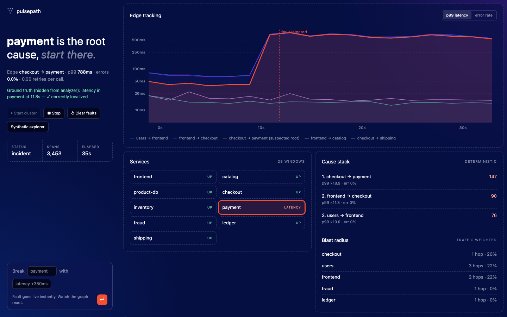

# Pulsepath



See [DEMO.md](DEMO.md) for a step-by-step walkthrough and a [demo GIF](docs/demo/pulsepath-demo.gif).

This repository diagnoses degradation from **raw OpenTelemetry spans and proxy access logs**. It reconstructs a service dependency graph, calculates per-edge error rate and p50/p95/p99 from raw samples, applies SLO burn alerts, detects onset using a deterministic CUSUM, ranks likely roots deterministically, and estimates traffic-weighted blast radius.

## Run

```sh
make demo-fault
cat run/report.json
make test
make benchmark
```

`make demo-fault` uses a deterministic stand-in for an instrumented multi-service demo under load: 12 minutes of raw spans/access logs, with a hidden payment-latency fault starting in minute five. Its inputs are emitted at `run/spans.json` and `run/proxy.jsonl`; the diagnoser reads only the former. The hidden label is deliberately kept in `run/hidden_truth.json`, outside the analyzer input.

## Live cluster (real services)

```sh
make ui    # then open http://127.0.0.1:8080/web/live.html
```

Press **Start**: nine real HTTP microservices (`frontend, catalog, product-db, checkout, inventory, payment, fraud, ledger, shipping`) launch as separate OS processes (`src/diag/live/service.py`) and a load generator drives them. Each service does real work, calls peers over HTTP with trace-context headers, and ships client spans and access logs to the collector at `/v1/ingest` (also written to `run/live/spans.jsonl`, `proxy.jsonl`). The analyzer reruns on the accumulating spans every 2 s. Inject latency, errors, a retry storm, or kill a service outright; the injected fault is shown only as ground truth beside the diagnosis and is never an analyzer input. The **Incident report** button (or `GET /api/live/incident.md`) downloads a Markdown record of the run: summary, ranked suspects, blast radius, SLO alerts and recommended next steps. Offline, `python3 -m diag.cli analyze spans.json --markdown incident.md` produces the same report. `make test` includes a ~2 minute end-to-end test that boots the cluster once per fault type (latency, errors, retry storm, process down) and checks that `payment` is localized each time. CI runs the suite on Python 3.9 and 3.12.

## Large synthetic corpus

Generate a 28-service, 28-edge corpus with 60 minutes of traffic using:

```sh
make synthetic-large
```

The default produces roughly 196,000 raw spans and matching JSON-lines proxy records at `data/synthetic-large/`, with a hidden payment fault starting halfway through the run. It is ignored by Git. Increase volume deterministically with `PYTHONPATH=src python3 -m diag.cli generate-large --minutes 120 --requests-per-minute 1000`.

For a live OpenTelemetry Demo/Online Boutique run, configure the collector's file exporter (`configs/otel-collector.yaml`) and invoke:

```sh
PYTHONPATH=src python3 -m diag.cli analyze /path/to/exported-spans.json --out report.json
docker compose -f docker-compose.real-demo.yml --profile load run k6
```

The compose file supplies Toxiproxy and k6. Add toxics through its API to cover latency, errors/downstream-unavailable, and retry storms. Those experiment identities must never be supplied to `diag analyze`.

## Method and evaluation

- **Graph:** each client span with `peer.service`/`server.address` creates `source -> peer`.
- **Metrics:** samples are grouped per edge; nearest-rank p50/p95/p99 comes directly from span durations. This is an exact raw-sample histogram equivalent for this compact implementation.
- **SLO:** 99% availability, fast-burn alert when both the 5-minute and 60-minute error-budget burn rate reach 14.4×.
- **Change point:** one-sided CUSUM over per-minute edge error rate.
- **Root cause:** a stable score combining edge errors, retry amplification, earlier failure onset, and caller fan-in. Ties break lexicographically. No LLM participates.
- **Blast radius:** reachable callers/dependencies are sorted by observed call share, rather than merely graph reachability.

The `benchmark` command runs four hidden deterministic fault cases (simulated data) and reports top-1/top-3 and the measured detection lag in windows, computed against the hidden onset minute. The intended next validation is to replace the simulator with captured raw exports and compute p99 against k6's `http_req_duration` and Prometheus's histogram quantile for the same aligned window. Compare `report.json`'s graph against the selected demo's topology documentation; service aliases and async edges should be normalized first.

For a public labeled RCA benchmark, use the same `diag analyze` input adapter against an incident dataset such as AIOps 2020/KPI Anomaly Detection; an adapter is required because those datasets do not share OTLP's span schema. Do not claim accuracy until labels and timestamps are aligned.

See [limitations](docs/limitations.md) for known failure modes.
